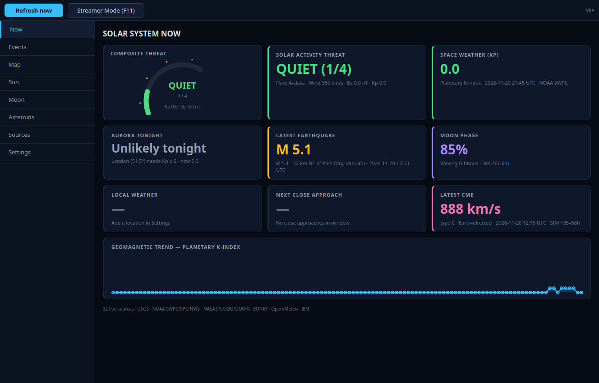
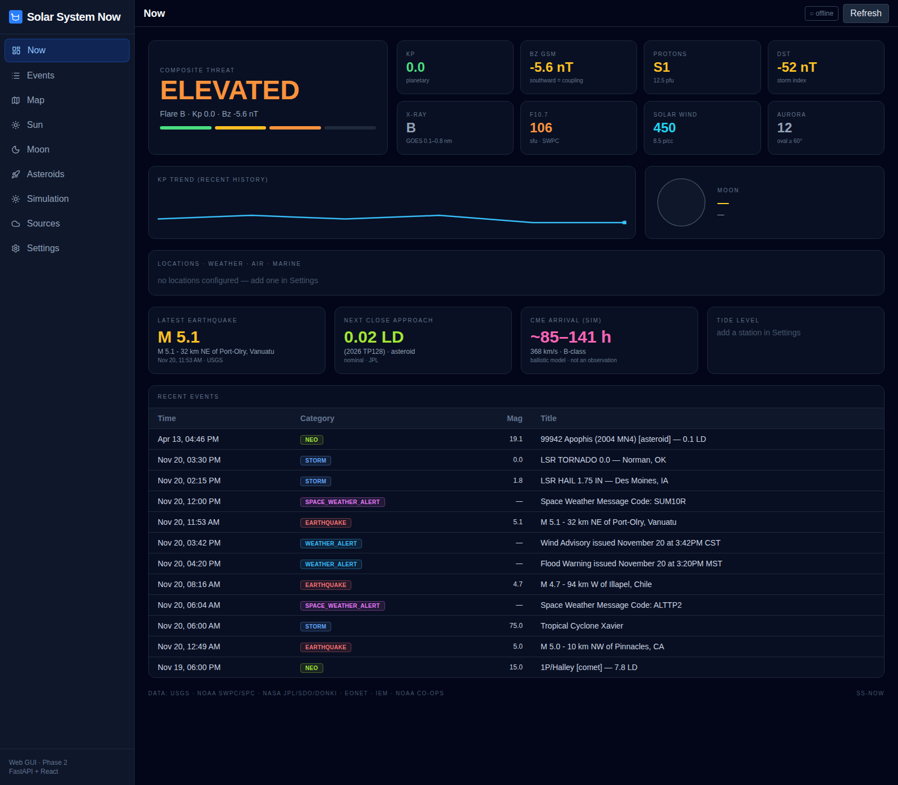
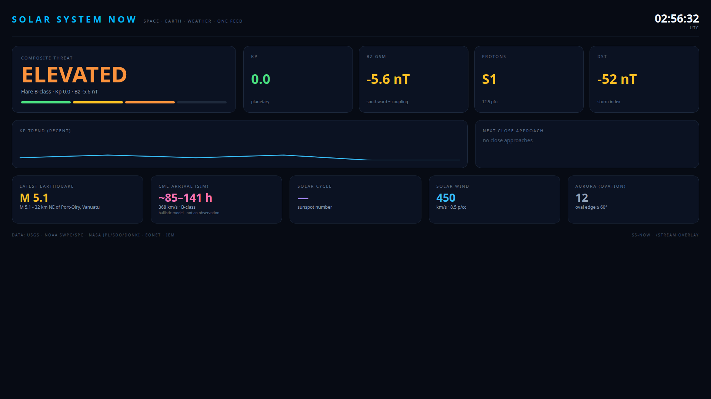

# Solar System Now (ss-now)

[](https://github.com/kdsmith18542/SolarSystemNow/actions/workflows/ci.yml)
[](https://github.com/kdsmith18542/SolarSystemNow/releases)

Linux desktop + local web dashboard for reviewing **current and historical real data** about Earth and its solar neighborhood: earthquakes, tsunamis, volcanoes, storms, wildfires, floods, weather, tides, space weather (Kp, solar wind, IMF Bz, flares, protons, Dst), the Sun (SDO/LASCO imagery), the Moon, and near-Earth asteroids, comets, fireballs and impact risk. No fabricated data, no server required, no hosting costs.


*Desktop: composite threat dial, Kp/Bz/proton/Dst cards, aurora verdict, quake + CME watch, Kp trend.*


*Web dashboard: same live data — threat hero, solar-wind/aurora metrics, per-location weather, event table with category chips.*


*`/stream`: chrome-free OBS browser-source overlay (`?compact=1`, `?bg=transparent`).*

## Architecture

- `ssnow_core/` — pure-Python library: 32 ingestion adapters, SQLite store (WAL + R-Tree + notifications), scheduler, deterministic physics sims, CLI. No Qt imports (enforced by test).
- `ssnow_desktop/` — PySide6/Qt GUI: Now, Events, Map, Sun, Moon, Asteroids, Sources, Settings. System-tray alerts, OBS streamer mode (F11).
- `ssnow_web/` — FastAPI + React/Tailwind/MapLibre, SSE live stream, builds into `static/`.
- Data sources (all free, public domain / permissive): USGS, NASA EONET, Open-Meteo, NOAA SWPC (Kp, X-ray, F10.7, RTSW wind/IMF, protons, Dst, solar cycle), NASA DONKI, JPL NeoWs/CAD/fireballs/Sentry, NOAA SPC outlooks, IEM storm reports, NWS alerts, OVATION aurora, NDBC tides, geomag, SDO/LASCO imagery, Skyfield Moon.
- Local SQLite database + gzipped raw snapshots; steady-state storage is single-digit GB.

## Setup

```bash
python3 -m venv .venv
source .venv/bin/activate
pip install -e .[dev,gui,web]
```

## Run

```bash
# ingest due sources once
ssnow ingest

# stats
ssnow stats

# prune snapshots & observations older than N days
ssnow prune --days 90

# launch desktop GUI
ssnow gui

# run a deterministic physics simulation (labels SIMULATION, never a forecast)
ssnow sim --list
ssnow sim --id flare_arrival --param cme_speed_km_s=800

# web dashboard (needs npm run build in ssnow_web/ first)
ssnow-web --port 8123
```

Environment overrides: `SSNOW_DATA_DIR`, `SSNOW_CONFIG_DIR`, `SSNOW_CACHE_DIR`. Extra flags: `--log-level`.

## Remote server mode (desktop ↔ ssnow-web)

Run `ssnow-web` on a home server/NAS and point the desktop at it:

1. Start the server: `ssnow-web --port 8123` (or `docker compose`, below).
2. Desktop → **Settings → Server connection** → tick the box, enter `http://host:8123`, Save, restart.
3. Ingest now happens server-side (`POST /api/ingest`); the desktop reads over HTTP and shows `(remote server)` in the title.

If the server is unreachable at startup the desktop falls back to standalone with a logged warning. The NASA key never leaves the server; leaving the key field blank keeps the stored one. Backup export is standalone-only.

Set `SSNOW_API_TOKEN` on the server to require a write token for `POST /api/ingest`, `/api/settings` and `/api/sim/run` (header `X-SSNOW-Token` or `Authorization: Bearer …`); paste the same token into the desktop Settings server section. GETs always stay public. In remote mode the desktop also follows the server's SSE live stream, so it refreshes the moment an ingest finishes.

## Self-hosting (Docker)

```bash
(cd ssnow_web && npm run build)          # bundle into ../static/
docker compose -f packaging/docker-compose.yml up -d --build
# http://<host>:8123 — data persists in the ssnow-data volume
```


## Packaging (Linux)

Prebuilt AppImage: see [Releases](https://github.com/kdsmith18542/SolarSystemNow/releases).

```bash
# from the repo root (downloads appimagetool on first run; no FUSE needed)
sh packaging/build_appimage.sh
# produces dist/ssnow (PyInstaller bundle) and packaging/Solar_System_Now-x86_64.AppImage
```

## Hardware / GPU

No CUDA or GPU toolkit is required. Ingest is HTTP/JSON; charts are Qt-painted; the map uses QtWebEngine, which falls back to software rendering if OpenGL is unavailable (`QTWEBENGINE_CHROMIUM_FLAGS=--disable-gpu`).

## Data integrity

Missing data renders as missing; nothing is synthesized. Every view shows source attribution and upstream links. Radar is a live overlay only (never stored). CME arrival figures are ballistic SIMULATIONs, always labelled as models — never presented as observations.
